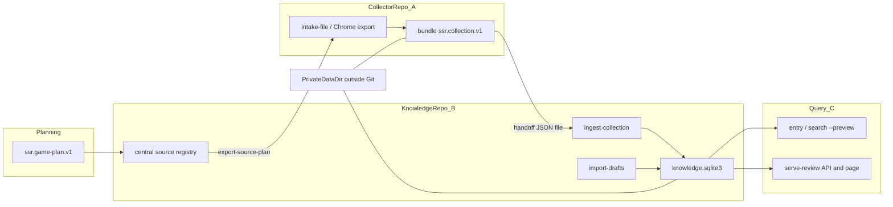
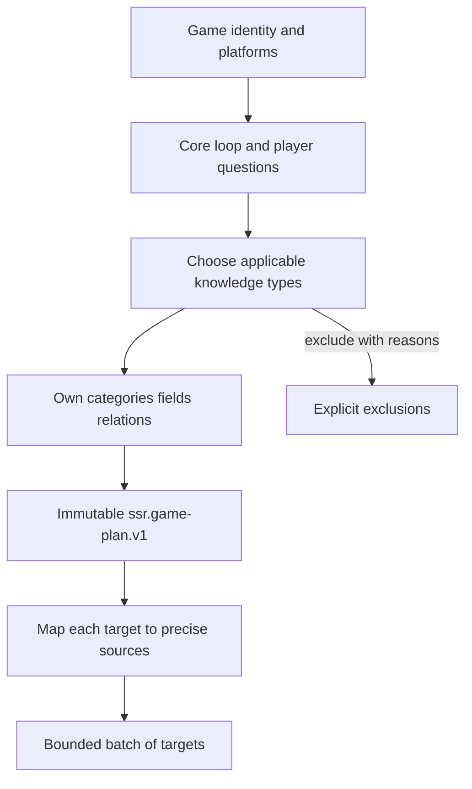
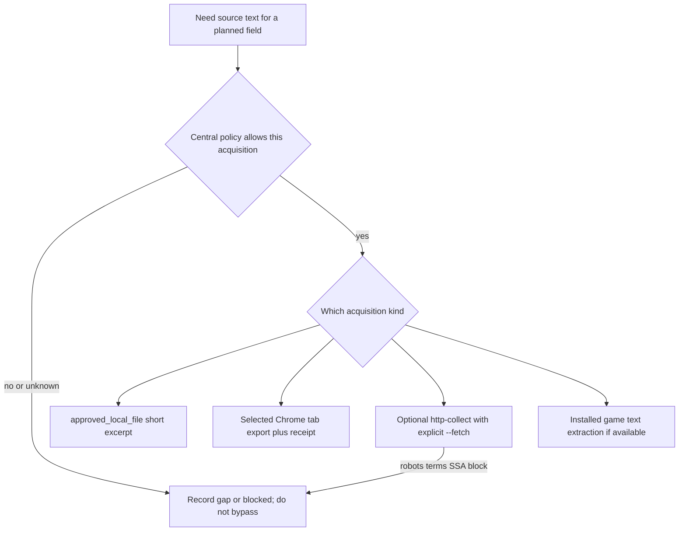
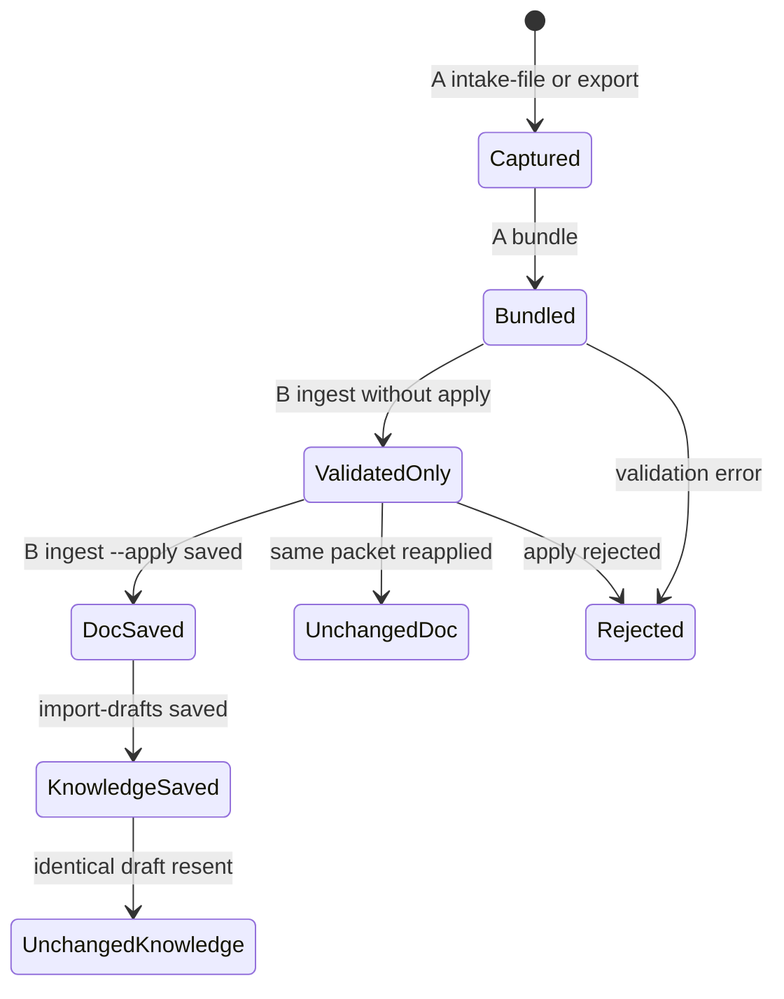
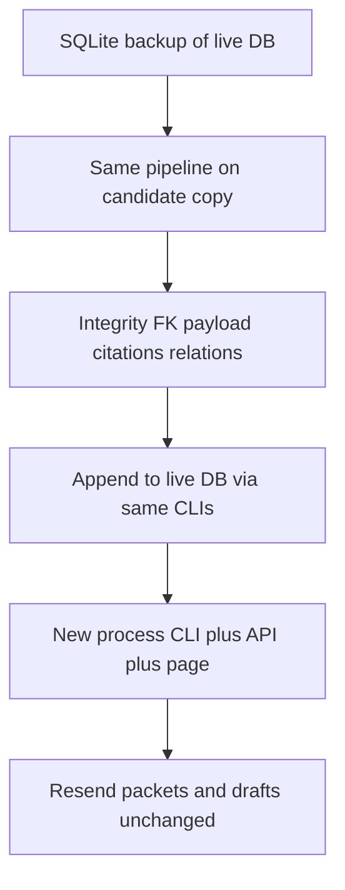

# 可複用遊戲知識採集 Playbook

給使用者一次看懂「怎麼抓、怎麼存、怎麼驗」，並讓**其他遊戲**複製同一套責任切分與契約。  
**不要**照搬 PEAK 的分類表或任何網站導覽當 taxonomy。

契約 SSOT 在本 repo；擷取端規劃細節見 collector 的 [遊戲知識規劃](https://github.com/HGPT-StreamSuite/ssr-collector-peak/blob/codex/collector-acceptance/docs/game-knowledge-planning.md)。PEAK 數量以實際 DB 與最新 acceptance 為準，本頁不當成過時數字的權威來源。

---

## 1. 一句話模型

**先分析要存什麼 → A 只交原文檔 → B 先收文件再寫待審知識 → C 直接查同一 DB 給人驗收。**

查證紀錄、待辦清單、單元測試綠燈、文件 snapshot **都不算**知識完成。找到可用補充後，必須走完保存與讀回。

---

## 2. 系統架構

兩個獨立 checkout，**禁止跨 repo import**；以版本化 JSON 檔交接。來源政策、SQLite、草稿與原文放在 **checkout 外**的私有資料目錄。



| 元件 | 職責 | 不負責 |
|------|------|--------|
| Collector（A） | 取得原文／觀測、暫存、輸出 `ssr.collection.v1` | 寫 knowledge DB、審核、發布、正式搜尋 |
| Knowledge（B） | 中央來源政策、收納 snapshot、驗證計畫與草稿、寫待審修訂 | 代替使用者批准；在採集流程自動 publish |
| Query（C） | 每次唯讀開 DB，依查詢條件顯示實際結果 | 匯入、批准、改寫正文、改讀別套 DB 充數 |
| Private data-dir | DB、來源原文、草稿、備份、交接包 | 不得提交 Git |

---

## 3. 端到端序列

```mermaid
sequenceDiagram
  participant Planner
  participant B as Knowledge_B
  participant A as Collector_A
  participant Editor
  participant C as Query_C
  Planner->>B: register-game-plan
  Planner->>B: register-file-source or register-sources
  B->>A: export-source-plan file copy
  A->>A: intake-file or browser export
  A->>B: bundle ssr.collection.v1
  B->>B: ingest-collection validated_only
  B->>B: ingest-collection --apply
  Note over B: Document saved only; no knowledge entry yet
  Editor->>B: import-drafts from pinned snapshots
  B->>B: pending_review revision
  B->>C: same data-dir
  C->>C: entry / API / serve-review read-back
```

命令形狀（路徑請換成該次私有目錄；沿用既有 `uv --offline run --no-sync`）：

```powershell
# B：登記計畫與本機檔案來源，匯出計畫給 A
uv --offline run --no-sync python -m ssr_knowledge catalog --data-dir C:\private\game-data register-game-plan --file C:\handoff\game-plan-v1.json
uv --offline run --no-sync python -m ssr_knowledge catalog --data-dir C:\private\game-data register-file-source --file C:\handoff\source-config.json
uv --offline run --no-sync python -m ssr_knowledge catalog --data-dir C:\private\game-data export-source-plan --source-id SOURCE_ID > C:\private\source-plan.json

# A：暫存並打包（collector checkout）
uv --offline run --no-sync python -m ssr_collector_peak intake-file --plan C:\private\source-plan.json --source-id SOURCE_ID --file C:\private\excerpt.txt --stage-dir C:\private\spool --format plain_text --origin operator_file
uv --offline run --no-sync python -m ssr_collector_peak bundle --stage-dir C:\private\spool --snapshot-id SNAPSHOT_ID --output-dir C:\private\handoff

# B：先驗證再明確保存文件；再匯入整理草稿
uv --offline run --no-sync python -m ssr_knowledge catalog --data-dir C:\private\game-data ingest-collection --file C:\private\handoff\ID.collection.json
uv --offline run --no-sync python -m ssr_knowledge catalog --data-dir C:\private\game-data ingest-collection --file C:\private\handoff\ID.collection.json --apply
uv --offline run --no-sync python -m ssr_knowledge catalog --data-dir C:\private\game-data import-drafts --file C:\private\drafts.json

# C：新程序讀回；查詢頁綁同一 data-dir
uv --offline run --no-sync python -m ssr_knowledge catalog --data-dir C:\private\game-data entry --entry-id ENTRY_ID
uv --offline run --no-sync python -m ssr_knowledge catalog --data-dir C:\private\game-data serve-review --port 8767
```

詳細欄位與拒收規則：[collection-contract-v1.md](collection-contract-v1.md)、[collection-handoff.md](collection-handoff.md)、[persistence-and-query-acceptance.md](persistence-and-query-acceptance.md)、[live-review.md](live-review.md)。擷取端操作：[file-handoff.md](https://github.com/HGPT-StreamSuite/ssr-collector-peak/blob/codex/collector-acceptance/docs/file-handoff.md)。

---

## 4. 三環節責任

| 環節 | 完成長相 | 常見誤判 |
|------|----------|----------|
| **A 擷取** | 有 `ssr.collection.v1`、可核對 raw／body 雜湊與來源 ID | 以為「網頁能開」就等於已擷取 |
| **B 文件收納** | `ingest-collection --apply` 後有 snapshot／receipt | 以為收納完成＝條目已入庫 |
| **B 知識保存** | `import-drafts` 回傳 `saved` + `pending_review` | 草稿 JSON 躺在磁碟卻未匯入 |
| **C 查詢驗收** | 同一 DB 的 CLI／API／頁面內容與 revision 一致 | 用靜態 HTML、舊報告或另一套合成 DB 充數 |

A 與 B／C 可不同程序、不同時間執行；**不要求**常駐服務綁定。

---

## 5. 規劃先於抓取

網站分類只能當來源定位，**不能**直接當 DB taxonomy。每款遊戲各自分析後交付 `ssr.game-plan.v1`。



規劃交付物（摘要，完整見 [game-knowledge-planning.md](https://github.com/HGPT-StreamSuite/ssr-collector-peak/blob/codex/collector-acceptance/docs/game-knowledge-planning.md) 與 [game-plan-contract-v1.md](game-plan-contract-v1.md)）：

1. 根分析：識別、玩法、問題清單、版本界線、排除理由。  
2. 自有分類：納入／排除理由、粒度、類別界線。  
3. 條目與欄位：穩定 ID、問題、型別／單位、缺漏表示。  
4. 關聯：方向、語意、兩端須存在；證據不可「同頁出現就亂連」。  
5. 來源對照：精確 URL／段落／表列／官方 key。

特殊類別：

- **介紹**：玩法與結構；無據世界觀留缺口。  
- **評價**：作者、日期、立場、理由、量尺；不冒充官方事實。  
- **官方更新**：`allowed_source_types` **只能是 official**；Wiki 轉述不得填入 update 類別。

契約限制（落地時必須遵守）：計畫 `game` 目前實作為可擴充識別（PEAK 範例為 `PEAK:3527290`）；每份計畫 `targets` 最多 **100**；內容變更須新 `plan_id`（同 ID 同內容重送不變）。

---

## 6. 取得方式決策



| 方式 | 何時用 | 注意 |
|------|--------|------|
| `approved_local_file` | 操作者已合法取得的短摘錄／附件；真實批次常用主路徑 | `allow_fetch=false`；`url=approved-file:SOURCE_ID`；出處 HTTPS 放 `original_url` |
| 本機 Chrome 匯出 | 已許可來源、選定 tab；可附 `capture_receipt` | 不自行導覽、不開 DB；metadata 不是權限簽章 |
| 可選 HTTP `http-collect` | 架構保留；預設 dry-run | 須中央核可＋明確 `--fetch`；未知用途保持 unknown |
| 安裝版遊戲字串 | 官方 UI 名稱等 | 與網站抓取分開；需可核對 build／路徑 |

**禁止**：換 UA／代理／鏡像繞過 robots、條款或 Steam Subscriber Agreement 自動化限制；把「瀏覽器能看」當成採集許可；用模組參數或傳聞填成官方數值。

來源政策在 B 的 `sources.config_json` 分四用途：`local_cache`、`search_index`、`ai_input`、`ai_train`，各有 status 與 basis。Snapshot 保留當下政策作歷史；正式查詢仍看**現行**中央政策。

---

## 7. 交接格式與文件狀態

`ssr.collection.v1` 根欄位恰好五個：`format`、`producer`、`source_ref`、`document`、`bundle_id`。  
包內**不得**帶權限授予、審核／發布指令、內部 entry／revision ID、或模型答案。



| 狀態 | 意義 |
|------|------|
| A `saved`／`unchanged` | 暫存／打包層去重 |
| B `validated_only` | 只檢查、預設不寫 DB |
| B `saved`／`unchanged`／`saved_historical` | 文件（snapshot）層 |
| 知識 `saved`＋`pending_review` | 條目修訂已寫入；**尚未**批准發布 |

文件已存 ≠ 知識已存。知識更新以**新修訂**保留歷史；相同 payload 重送必須 `unchanged`，不得重複灌水。

---

## 8. 知識寫入與審核邊界

1. 編輯者（人或 agent）依**已保存** snapshot 正文整理草稿；每個規劃欄位要有 `value`＋精確引文，或明列 `gaps`。  
2. 引文必須是 pinned body 的子字串；`evidence_class`／來源 `source_type` 須落在該分類 `allowed_source_types`。  
3. `import-drafts` 驗證計畫目標、欄位集合、關聯方向後寫入。  
4. 新內容一律 `pending_review`。`review-entry`／`publish-entry` 是**另一步**人工操作；採集／補資料流程**不**自動批准。  
5. 正式 `search` 預設看不到待審；驗收用 `--preview` 或 `serve-review`。`no_data` 可能只是未發布，不能當「沒保存」。

---

## 9. 驗收閉環與進度六態

寫入正式 DB 前：SQLite backup → **候選庫**跑同一套 ingest／import → 通過後再追加原庫；**禁止**用候選庫覆蓋原庫。



進度至少分開記（不可混成同一個「完成」）：

| 階段 | 含義 |
|------|------|
| 已規劃 | 計畫目標存在 |
| 找到未擷取 | 知道 URL／線索，尚無交接包 |
| 已擷取未收納 | 有 collection 檔，尚未 `--apply` |
| 文件已存但知識未存 | 有 snapshot，尚無／未更新修訂 |
| 知識已存未顯示 | 有 pending 修訂，查詢未對到或未 preview |
| 已讀回並查詢顯示 | CLI／API／頁面與 DB 一致 |

受阻另記：來源未提供、取得失敗／受限、驗證拒收。

查詢頁規則：每次新開唯讀連線；失敗就報錯；不回退示範資料或上次快取。見 [live-review.md](live-review.md)。

---

## 10. 他遊戲採用檢查清單

- [ ] 新建或沿用 **獨立 collector**（或相容 producer 名稱／語意化版本），不 import knowledge 套件。  
- [ ] 在 knowledge 為該遊戲準備 **checkout 外** `data-dir`；合成測試 DB 與真實 DB 分開。  
- [ ] 完成根分析與第一份 `ssr.game-plan.v1`（自有分類；targets ≤ 100；變更用新 plan_id）。  
- [ ] 中央登記來源：`register-file-source` 或允許的 manifest；四用途政策寫清；禁止用途維持 prohibited。  
- [ ] A 產出至少一份真實或合成 `ssr.collection.v1`，B `ingest-collection --apply` 成功。  
- [ ] 整理至少一筆有引文的草稿，`import-drafts` → `pending_review`。  
- [ ] 新程序 `entry`／`relations`／`game-plan-status` 讀回；`serve-review` 同一 DB 可開條目。  
- [ ] 重送來源包與草稿皆 `unchanged`。  
- [ ] 文件化該遊戲的受限來源與缺口；不宣稱「全遊戲已抓完」。  
- [ ] （可選）安裝版官方字串擷取與網站摘錄分來源保存。

擴充能力時：新分類／欄位若超出目前 `Catalog`／game-plan 驗證器，先改契約與測試，再收真實資料。

---

## 11. 附錄：PEAK 範例（非完成宣告）

PEAK 用來證明本方案可端到端跑通，**不**代表所有版本、所有生物、所有公告、所有評價或 Steam 商店原文都已收齊。

| 項目 | 說明 |
|------|------|
| 雙 repo | `ssr-collector-peak`（A）＋ `ssr-knowledge`（B／C） |
| 計畫 | 多份不可變 `peak-*-v1`（core／survival／expedition／late-game／challenges／supplies） |
| 取得 | 以獲准本機摘錄與選定瀏覽器段落為主；Steam 商店自動化仍受限 |
| 查詢 | 本機真實驗收常用 `serve-review --port 8767`（與合成 8766 分開） |
| 狀態 | 規劃範圍條目已入庫者仍多為 `pending_review`；欄位缺口與受限來源見最新 acceptance／[peak-coverage.md](peak-coverage.md) |

數字與修訂號請以實際 `knowledge.sqlite3` 及下列紀錄為準，勿只信 README 舊摘要：

- [peak-completion-acceptance.md](peak-completion-acceptance.md)  
- [peak-timer-integrity-acceptance.md](peak-timer-integrity-acceptance.md)  
- [peak-reception-expand-acceptance.md](peak-reception-expand-acceptance.md)  

---

## 12. 相關文件索引

| 文件 | 用途 |
|------|------|
| [persistence-and-query-acceptance.md](persistence-and-query-acceptance.md) | A→B→C 完成定義與命令 |
| [collection-contract-v1.md](collection-contract-v1.md) | `ssr.collection.v1` 欄位與拒收 |
| [game-plan-contract-v1.md](game-plan-contract-v1.md) | `ssr.game-plan.v1` 與草稿驗證 |
| [live-review.md](live-review.md) | 唯讀查詢頁 |
| [peak-coverage.md](peak-coverage.md) | PEAK 來源已收／待收／受限盤點 |
| Collector [game-knowledge-planning.md](https://github.com/HGPT-StreamSuite/ssr-collector-peak/blob/codex/collector-acceptance/docs/game-knowledge-planning.md) | 規劃方法論 |
| Collector [file-handoff.md](https://github.com/HGPT-StreamSuite/ssr-collector-peak/blob/codex/collector-acceptance/docs/file-handoff.md) | A 端交接操作 |
